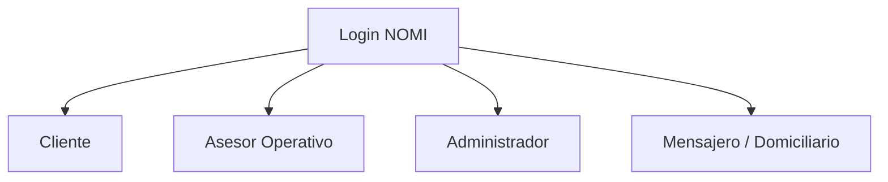

# 📱 Guía Definitiva para la Exposición de la App NOMI

Esta guía está diseñada para tu presentación. No se enfoca en líneas de código, sino en **la arquitectura funcional, el stack tecnológico, los 4 roles de usuario y los flujos operativos** de la plataforma logística NOMI.

---

## 1. Stack Tecnológico (¿Qué se utilizó?)

* **Frontend (Aplicación Móvil Android):**
  * Desarrollado en **Android Studio**.
  * Lenguaje principal: **Kotlin** (moderno, seguro y eficiente para Android) junto con interoperabilidad nativa.
  * Interfaz de usuario (UI): Diseños adaptativos modernos con Material Design 3, navegación por Intents y flujos multi-pantalla optimizados.
* **Backend y Base de Datos:**
  * **Supabase** como plataforma de Backend-as-a-Service (BaaS).
  * **PostgreSQL** como motor de base de datos relacional en la nube (tablas altamente normalizadas para clientes, asesores, mensajeros, pedidos y planillas).
  * Autenticación segura gestionada directamente con Supabase Auth (correo y contraseña con encriptación).

---

## 2. Los 4 Roles y Perfiles del Sistema

NOMI gestiona un modelo de permisos basado en 4 perfiles diferenciados desde el inicio de sesión:

1. **Cliente:** Usuario final que requiere cotizar envíos, rastrear sus paquetes y comunicarse con soporte.
2. **Asesor Operativo:** Personal de ventanilla u oficina encargado de crear los pedidos, registrar remitentes/destinatarios y atender PQRS (Peticiones, Quejas, Reclamos).
3. **Administrador:** Gerente o supervisor con control total sobre la plataforma: supervisa pedidos, gestiona usuarios (crea asesores y mensajeros), revisa indicadores financieros/operativos y **crea planillas de despacho**.
4. **Mensajero / Domiciliario:** Conductor u operador logístico encargado de recibir las planillas de ruta, auditar la carga y realizar las entregas de última milla.

---

## 3. Flujos Funcionales por Rol (Paso a Paso para Exponer)

### 👤 Rol 1: Cliente
* **¿Qué hace en la app?**
  * **Cotizar Envío:** Ingresa origen, destino, peso y dimensiones para calcular el costo estimado del servicio en tiempo real.
  * **Rastrear Pedido:** Introduce el número de guía (ej. `N050001`) para conocer el estado actual de su paquete (Solicitado, En Tránsito, Entregado).
  * **PQRS:** Puede generar peticiones, quejas o reclamos y consultar su estado y respuesta.
  * **Perfil y Soporte:** Gestiona su información personal y accede a canales de contacto.

### 🎧 Rol 2: Asesor Operativo (Oficina)
* **¿Qué hace en la app?**
  * **Creación de Pedidos (El núcleo operativo):** Recibe al cliente en ventanilla y registra el envío paso a paso (`RemitenteActivity` ➔ `DestinatarioActivity` ➔ `DetallesPedidoActivity` ➔ `FinalizarPedidoActivity`).
  * **Registro en Base de Datos:** Cada pedido creado se almacena automáticamente en PostgreSQL con estado `1` (Solicitado / En Oficina) y queda disponible en la bolsa de trabajo de la oficina.
  * **Atención de PQRS:** Resuelve las solicitudes e inquietudes de los usuarios.
  * **Cotización y Rastreo:** Apoya al cliente con cotizaciones rápidas y seguimiento de guías.

### 🛠️ Rol 3: Administrador
* **¿Qué hace en la app?**
  * **Supervisión General:** Visualiza el listado completo de todos los pedidos creados por los asesores a nivel nacional o local.
  * **Gestión de Personal:** Da de alta a nuevos Asesores (`perfil_asesor`) y Mensajeros (`perfil_mensajero`) con credenciales seguras.
  * **Indicadores y Métricas:** Panel con estadísticas de operación, volumen de entregas y rendimiento.
  * **Creación de Planillas de Despacho (Manifests):**
    * Agrupa los pedidos pendientes creados por los asesores en un lote logístico.
    * Selecciona el CD de origen, CD de destino, vehículo y **asigna un mensajero específico**.
    * Al generar la planilla, los paquetes cambian automáticamente a estado `2` (En Ruta / Planillados).

### 🛵 Rol 4: Mensajero / Domiciliario
* **¿Qué hace en la app?**
  * **Planillas Asignadas:** Ingresa a su sección de "Mis Planillas y Rutas" para ver qué lotes de paquetes tiene asignados su usuario.
  * **Auditoría de Carga:** Visualiza el detalle de cada guía dentro de su planilla (origen, destino, destinatario) para confirmar la carga en el vehículo.
  * **Historial de Entregas:** Consulta un resumen de los paquetes transportados y entregados con éxito durante su jornada.

---

## 4. ¿Cómo se almacena y gestiona la información? (Base de Datos)

Para explicar cómo funciona el almacenamiento ante el jurado:
* **Base de Datos Relacional (PostgreSQL en Supabase):**
  * Tenemos tablas especializadas: `perfil_cliente`, `perfil_asesor`, `perfil_mensajero`, `perfil_admin`, `pedidos`, `planillas` y `pqrs`.
* **Relaciones Clave:**
  * La tabla `pedidos` tiene una relación directa con el cliente, el mensajero y **la planilla (`id_planilla`)**. Esto permite la trazabilidad completa desde que el asesor crea el paquete hasta que el mensajero lo transporta en su planilla de despacho.

---

## 5. Preguntas Clave que te puede hacer el Jurado

> **P: ¿Cómo sabe la app qué rol mostrar al iniciar sesión?**
> * **R:** Al hacer login, el sistema consulta de manera progresiva en las 4 tablas de perfiles de Supabase (`perfil_admin`, `perfil_asesor`, `perfil_mensajero`, `perfil_cliente`). Una vez encuentra el correo en una de las tablas, redirige al usuario a su panel correspondiente con los permisos adecuados.

> **P: ¿Qué es una Planilla de Despacho y por qué es importante?**
> * **R:** En logística, un mensajero no puede llevar paquetes sueltos sin control. La **Planilla (Manifest)** es un documento digital con estado que agrupa múltiples guías de envío bajo un mismo responsable (el mensajero) y un vehículo, permitiendo control de salida en oficina y recepción segura en los Centros de Distribución (CD).

> **P: ¿Por qué se eligió Kotlin y Supabase?**
> * **R:** Kotlin es el estándar moderno recomendado por Google para Android por su rendimiento, concisión y seguridad contra nulos. Supabase nos ofrece un backend robusto basado en PostgreSQL con sincronización en tiempo real y alta seguridad sin necesidad de construir un servidor propio desde cero.
